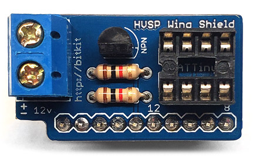
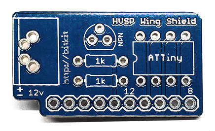
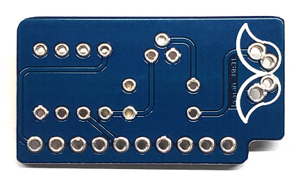
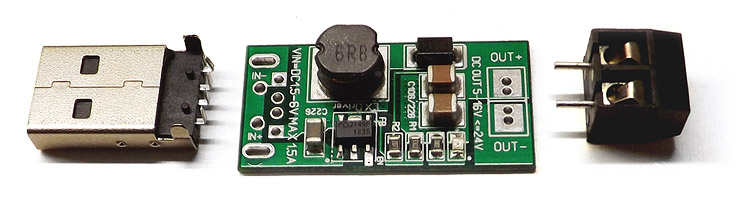

# HVSP Wing Shield

Ever accidently brick your ATtiny device by setting the fuse bits incorrectly? Or maybe you want to reclaim the reset pin and ditch the bootloader. High Voltage Serial Programming (HVSP) to the rescue. This circuit provides a small Arduino shield that enables you to rescue your 8-pin ATtiny devices from the junk box. There's also a version for ATtiny so they can rescue eachother.

See [Fuse Recovery](docs/FuseRecovery.md) for the various ways that fuses settings can lock out ISP programming.

## 12V Supply Requirement
In High Voltage Serial Programming, "high voltage" refers to 12V, which is well above the ATtiny's typical 5V operation. Common 12V supplies include wall adapters, generic USB boost converters that can be connected in various ways, and standard 12V batteries such as 23A/A23 cells.

## Programming from ATtiny

This shield was originally designed to work with an Arduino, but it can now also work with ATtiny devices. See [ATtiny Instructions](attiny/README.md) for more details.

# Availability

Boards available at [OSH Park](https://www.oshpark.com/shared_projects/0LHEovb9).

Kits available at [Tindie](https://www.tindie.com/products/gzip/avr-attiny-rescue-kit-hvsp-wing-shield-for-arduino/).

# Credit

Original Arduino sketch provided by [Rickety](http://www.rickety.us/2010/03/arduino-avr-high-voltage-serial-programmer/). ATtiny version assited by Antigravity.

# License

The hardware is licensed under [Creative Commons Share Alike](http://creativecommons.org/licenses/by-sa/4.0/). The Arduino sketch provides no explicit license.

